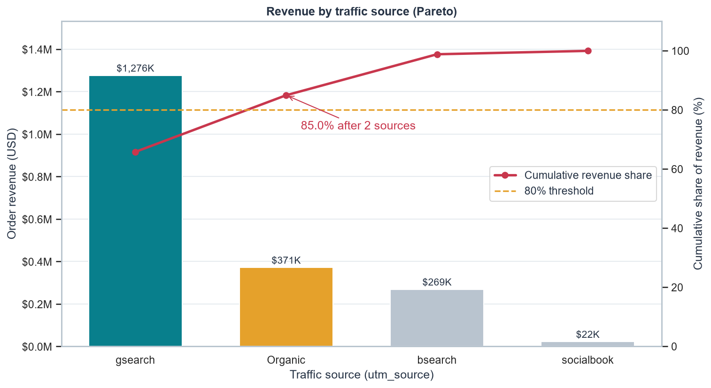
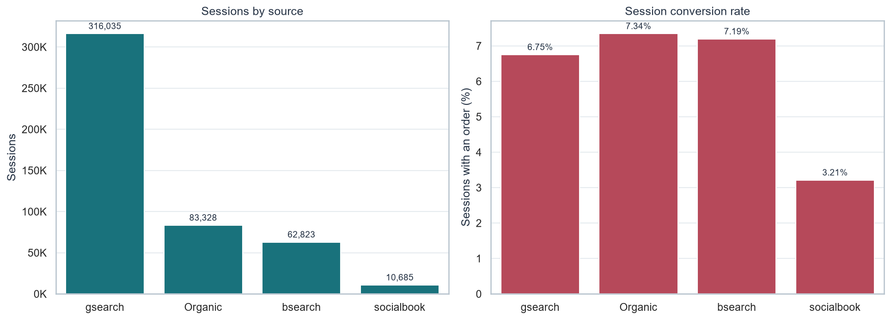

# Marketing Channel Pareto Analysis: Can TeddyWorld Cut Its Ad Budget in Half?

[](https://github.com/Haven-Pham/marketing-channel-pareto-analysis/actions/workflows/ci.yml)


## Overview

The CEO of TeddyWorld, an online stuffed-toy retailer, wants to cut advertising spend by 50%. This project applies
Pareto analysis to 32,313 orders and 472,871 website sessions (March 2012 to March 2015) to find which traffic
sources carry the business. It then sets out what evidence the cut would still need.

**Summary of results.** Two of four traffic sources produce 85% of revenue: `gsearch` (65.8%) and untagged traffic
(19.2%). One campaign, `gsearch` non-brand, accounts for 58% of all revenue on its own. Gross margin is about 63%
for every source, so margin does not separate the channels. Order data contain no ad spend, so the size and location
of the cut cannot be set from this data alone. The analysis gives a staged decision plan instead, with `socialbook` as
the first candidate.



## Business Questions

1. Which traffic source generates the most revenue?
2. How many sources produce about 80% of revenue?
3. Is there enough evidence to decide where a 50% budget cut should fall?

## Approach

- **Join with safeguards.** Orders are left-joined to sessions with a many-to-one check, and the totals are
  reconciled so that no order is lost or duplicated (all 32,313 orders matched a session).
- **Pareto.** Revenue by `utm_source`, sorted, with cumulative share. The 80% group includes the source that crosses
  the threshold.
- **Opening up "Organic".** Following the brief, untagged sessions are labelled Organic. The `http_referer` field then
  splits them into organic search ($197K) and direct type-in ($175K). Neither group is paid for, so neither can be
  cut.
- **Beyond revenue.** Sessions, session conversion rate, average order value, revenue per session and gross margin
  by source.

## Key Findings

| Source | Revenue | Share | Sessions | Conversion | Revenue per session |
|---|---:|---:|---:|---:|---:|
| gsearch | $1,276,145 | 65.8% | 316,035 | 6.75% | $4.04 |
| Organic (untagged) | $371,433 | 19.2% | 83,328 | 7.34% | $4.46 |
| bsearch | $268,673 | 13.9% | 62,823 | 7.19% | $4.28 |
| socialbook | $22,259 | 1.1% | 10,685 | 3.21% | $2.08 |

- `gsearch` leads because of **volume**: it brings two thirds of all sessions, and its conversion rate is slightly
  below the other search sources.
- `socialbook` is the outlier. It converts at less than half the rate of the other sources and earns half the
  revenue per session.
- Average order value is about $60 for every source, and gross margin is about 63% for every source.



## Recommendation

A 50% cut cannot be placed responsibly without spend data. The recommended path:

1. Collect ad spend by `utm_source` and `utm_campaign` for the same period, and compute ROAS and gross profit per
   dollar.
2. Cut in stages, starting with `socialbook`: it has the weakest conversion, and only 1.1% of revenue is at stake.
3. Protect `gsearch` non-brand until a holdout test measures its incremental return, because it is the single
   largest revenue engine.
4. Monitor organic search and direct traffic during the cuts, because paid search also builds brand demand.

## Repository Structure

```text
marketing-channel-pareto-analysis/
├── data/                    orders.csv, website_sessions.csv.gz, data dictionary
├── notebooks/               teddyworld_pareto_marketing.ipynb (analysis with outputs)
├── reports/
│   ├── figures/             Pareto chart, sessions and conversion chart
│   └── tables/              Pareto table and source performance (CSV)
├── scripts/run_notebook.py  re-executes the notebook
└── requirements.txt
```

## Reproducing the Analysis

```bash
pip install -r requirements.txt
python scripts/run_notebook.py
```

## Data

The *Maven Fuzzy Factory* e-commerce dataset (Maven Analytics), a public, fictional dataset for analytics training.
The session file is gzip-compressed; pandas reads it directly. Field definitions are in
[`data/README.md`](data/README.md).

## Limitations

- Revenue is order revenue before refunds and before marketing cost.
- Attribution is last-touch by session. Assisted conversions across channels are not measured.
- Without spend data, ROAS and the true efficiency of each channel cannot be calculated.

## Author

Pham Hong Hieu (Haven) · [Portfolio](https://haven-portfolio02.vercel.app) · [LinkedIn](https://www.linkedin.com/in/havenpham) · [GitHub](https://github.com/Haven-Pham)
